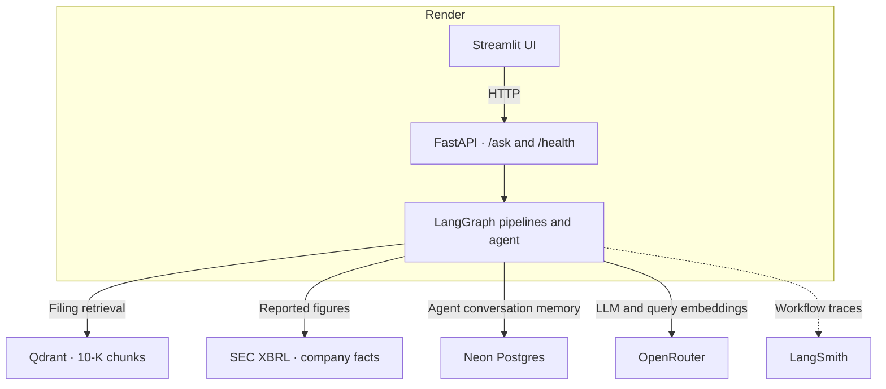

# 10-K Analyst

A RAG agent that answers questions about the SEC 10-K filings of ten US auto companies for fiscal years 2024 and 2025. It searches filing text and looks up reported figures in SEC XBRL data. The agent is designed to ground answers in retrieved evidence, cite its sources, and say when the requested information is unavailable.

**Stack:** LangGraph · Qdrant · FlashRank · OpenRouter · FastAPI · Streamlit · Neon Postgres · LangSmith · Render

**AI models**

- LLM — Anthropic Claude Haiku 5.5 (`anthropic/claude-haiku-5.5` by default via OpenRouter)
- Embeddings — OpenAI `text-embedding-3-small` via OpenRouter (1,536 dimensions)
- Reranker — FlashRank with `ms-marco-TinyBERT-L-2-v2`

<!-- Add a screenshot here:  -->

## What it covers

| Ticker | Company | Ticker | Company |
|---|---|---|---|
| TSLA | Tesla | APTV | Aptiv |
| GM | General Motors | BWA | BorgWarner |
| F | Ford | ALV | Autoliv |
| RIVN | Rivian | HOG | Harley-Davidson |
| LCID | Lucid | CVNA | Carvana |

That's 20 filings (10 companies × FY2024 and FY2025), split into 10,229 chunks.

## Five pipelines, from simple RAG to an agent

The project is built in stages, and every stage stays available so you can compare their answers side by side. Each pipeline is a LangGraph graph. Each one starts with a **scope check**, an LLM call that rejects questions about companies or years the data doesn't cover.

| Pipeline | Graph | What it adds |
|---|---|---|
| `simple` | `scope_check → retrieve → generate` | Basic RAG: top 5 chunks, no filters |
| `filters` | `scope_check → retrieve (filtered) → generate` | Searches only the companies and years in the question |
| `rerank` | `scope_check → retrieve (20) → rerank (keep 5) → generate` | FlashRank reranking for better chunks |
| `decompose` | `scope_check → decompose → search_part ×N (parallel, via Send) → generate` | Splits a comparison question into up to 4 sub-questions |
| `agent` | `create_agent` with two tools + Neon memory | Chooses between 10-K text search and SEC financial data, and remembers the conversation |

**The agent's tools**

- `search_10k(query, companies, years, items)`: filtered and reranked search over the 10-K text
- `sec_financial_data(ticker, metric, years)`: revenue, net income, R&D expense, and operating income from SEC XBRL company facts

## Architecture



LangSmith records pipeline runs with the pipeline name and chat thread ID when tracing is enabled.

## Project layout

```text
backend/ingest.py      reads the filings, chunks them by Item, embeds them, and stores them in Qdrant
backend/rag.py         search() and rerank() helpers, filters, and model setup
backend/sec_data.py    numbers from SEC XBRL company facts
backend/pipelines.py   scope check, generate_answer, the four graph pipelines, answer()
backend/agent.py       the agent, with tools and Neon memory
backend/api.py         FastAPI back end (/ask, /health)
frontend/app.py        Streamlit front end
data/                  the 20 filings (Markdown, split by Item) and filings.csv
tests/                 one test file per stage (stage 0 to stage 7)
test_data/questions.json   the test questions and expected results
render.yaml            Render Blueprint: two web services (API + UI)
```

## Run it locally

You need [uv](https://docs.astral.sh/uv/), plus accounts for OpenRouter, Qdrant Cloud, Neon, and LangSmith.

```bash
uv sync
cp .env.example .env        # then fill in your own keys
uv run python -m backend.ingest
```

Start the back end and the front end in two terminals:

```bash
uv run python -m uvicorn backend.api:app --port 8000
```

```bash
uv run python -m streamlit run frontend/app.py
```

Open http://localhost:8501 and enter the `ACCESS_CODE` from your `.env`.

Run the tests:

```bash
uv run pytest
```

## Example questions

- *What risks does Tesla report about battery supply?* (`simple`)
- *What does GM say about cybersecurity in 2024?* (`filters`)
- *Compare Tesla's and Ford's tariff risks in 2025.* (`decompose`)
- *What was Ford's R&D expense in 2025?* (`agent`, uses SEC data: $9.4 billion (FY2025))

## Deploy

`render.yaml` defines two free Render web services: the FastAPI back end and the Streamlit front end. In Render, choose **New → Blueprint**, select this repo, and type in the secrets when Render asks for them. Secrets are never stored in the repo.

Once the FastAPI service has a public Render URL, open the Streamlit service's **Environment** settings and set `API_URL` to that base URL (for example, `https://tenk-analyst-api.onrender.com`). Use the same `ACCESS_CODE` on both services and redeploy the frontend with the updated settings.

## Project Context

Developed as part of the Applied AI coursework at The University of Texas at Dallas, using Claude Code for assisted planning and implementation.
